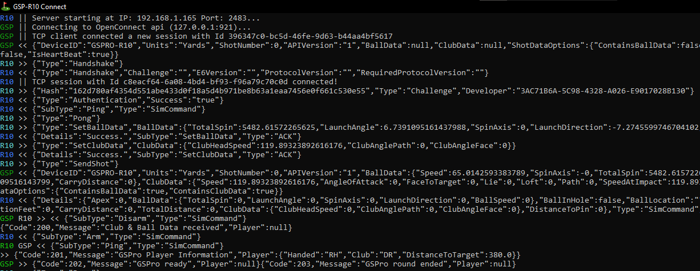

# gsp-r10-adapter

Utility to bridge R10 launch monitor to GSPro. Supports the following
  - An "E6 Connect" compatible server for use with the Launch Monitor's E6 integration
  - Direct bluetooth connection to R10
  - Webcam putting integration with https://github.com/alleexx/cam-putting-py

The goal of this project was to provide an ultra lightweight alterntive to the current offerings, with a focus on API transparency.




## Using Direct Bluetooth Connector

In order to use the direct bluetooth connection to the R10 you must
- Enable bluetooth in `settings.json` file
- Edit `settings.json` to reflect your desired altitude, tee distance, temperature, etc.
- Set device in pairing mode (blue blinking light) by holding power button for few seconds
- **Pair the R10 from the windows bluetooth settings**
  - On windows 11 you may need to set "Bluetooth Device Discovery" to `advanced`
  - This step only needs to be done once
  - You may need to disable bluetooth on previously paired devices to prevent them from stealing the connection

## Using the putting integration

In order to use the putting integration you must
- Enable putting in `settings.json` file
- Download ball_tracking software from https://github.com/alleexx/cam-putting-py/releases
  - If you want this program to manage opening/closing of putting camera, place ball_tracking in same folder as this program
- Read https://github.com/alleexx/cam-putting-py for webcam setup/troubleshooting
- Read putting section `settings.json` file to determine optimal settings for your setup


## Running

### From release

- Download either the standalone or net6 package from the release page. Extract zip to your local machine and run the exe file.
  - Use the standalone package if you are unsure whether your computer has a dotnet runtime installed
  - Use the net6 package if you believe your computer has a dotnet runtime installed.

### From Source

- Install a dotnet 7 sdk if you don't have one already
- `dotnet run` from project directory
## Running on Linux

The direct Bluetooth connection works on Linux through BlueZ (5.50 or newer). Tested on EndeavourOS (Arch) with an Approach R10.

### Requirements

- BlueZ with the Bluetooth service running
- .NET 10 SDK (only needed when building from source)

On Arch-based distros:

```
sudo pacman -S bluez bluez-utils dotnet-sdk
sudo systemctl enable --now bluetooth
```

For other distros, install BlueZ from your package manager and see Microsoft's guide for installing .NET on Linux.

### Pairing the R10

Pair the R10 once before running the bridge. The R10 only advertises when it is not connected to another device, so turn off Bluetooth on your phone or any previously paired computer first, then put the R10 in pairing mode (hold the power button until the light blinks blue).

**With a desktop environment:** open the Bluetooth menu from the system tray (or your desktop's Bluetooth settings), find `Approach R10` in the list of nearby devices, and pair with it.

**Without a GUI (or if the R10 doesn't show up):** use `bluetoothctl`:

1. Run `bluetoothctl`, then `power on` and `scan on`
2. Wait for `Approach R10` to appear, then run `pair <MAC>` and `trust <MAC>`
3. `scan off`, then `exit`

The R10 may not show its name right away. If you only see unnamed MAC addresses, turn the R10 off, start the scan, then turn it on in pairing mode and watch for the device that appears.

### From release

Download the `linux-x64` package from the releases page, extract it, then:

```
chmod +x gspro-r10
./gspro-r10
```

### From source

```
dotnet publish -f net10.0 -c Release -r linux-x64 --self-contained -o ~/r10-bridge
~/r10-bridge/gspro-r10
```

If GSPro runs on a different machine, edit `settings.json` in the output folder and change the `openConnect` IP from `127.0.0.1` to the IP of your GSPro PC.
